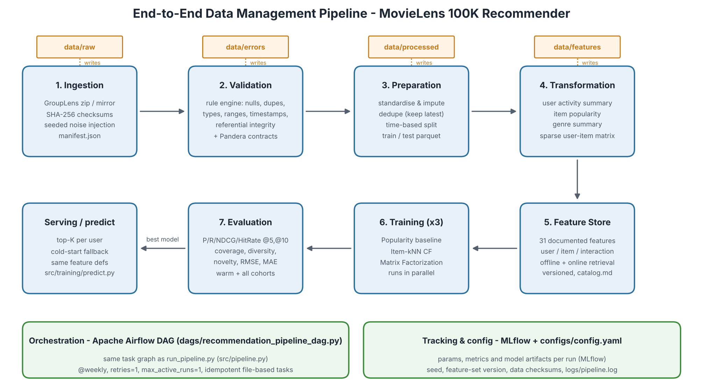

# End-to-End Data Management Pipeline for a Recommendation System

DM4ML Assignment 2. This is a reproducible, modular pipeline that takes the **MovieLens 100K** dataset from raw files to evaluated recommendation models:

```
Ingestion → Validation → Preparation → Transformation → Feature Store → Training (×3) → Evaluation
                                   orchestrated by Apache Airflow · tracked with MLflow
```



## What's inside

| Stage | Module | What it does | Main outputs |
|---|---|---|---|
| 1. Ingestion | `src/ingestion/ingest.py` | Downloads ML-100K (official GroupLens zip, or a GitHub mirror if that fails) and verifies SHA-256 checksums. Parses users, items and ratings into CSVs. Appends a **seeded, documented set of corrupted rows** so the validation stage has real errors to catch. | `data/raw/*.csv`, `ingestion_manifest.json` |
| 2. Validation | `src/validation/validate.py` | A rule engine checks for missing values, duplicates, bad types, invalid ratings and timestamps, referential integrity, invalid age/gender and more. Each rule is an `error` (the row is quarantined) or a `warning` (the row is kept and fixed later). Clean rows must then pass **Pandera** schema contracts. | `data/errors/*_errors.csv`, `reports/validation_report.md/.json` |
| 3. Preparation | `src/preparation/prepare.py` | Standardises formats and imputes missing release dates. Removes duplicate user-item ratings (keeps the latest). Makes a **time-based train/test split**. | `data/processed/train.parquet`, `test.parquet`, `split_metadata.json` |
| 4. Transformation | `src/transformation/transform.py` | Builds a user activity summary, item popularity, a genre summary and a sparse user-item matrix, all from the **train window only**. | `data/processed/*.parquet`, `interaction_matrix.npz` |
| 5. Feature management | `src/features/` | A file-based feature store with 31 documented features (user, item and interaction). Each feature is defined once and reused by training **and** prediction. Feature sets are versioned and the catalog is generated automatically. | `data/features/*.parquet`, `reports/feature_catalog.md/.csv` |
| 6. Training | `src/training/` | Trains a popularity baseline, item-kNN collaborative filtering and biased matrix factorization (SGD). Logs params, metrics and model artifacts to **MLflow**. | `models/<name>/model.pkl`, `mlflow.db` |
| 7. Evaluation | `src/evaluation/` | Computes Precision/Recall/NDCG/HitRate @5 and @10, Coverage, Diversity, Novelty, RMSE and MAE. Results go into a comparison table and figure, and are also logged back to each MLflow run. | `reports/model_comparison.md/.csv`, `reports/figures/model_comparison.png` |
| Orchestration | `dags/recommendation_pipeline_dag.py`, `run_pipeline.py`, `src/pipeline.py` | One task graph drives both the Airflow DAG and a plain-Python runner. | `reports/pipeline_run_log.json`, `reports/airflow_dags_test.log` |
| Serving | `src/training/predict.py` | Returns top-K recommendations for a user, using online features and a popularity fallback for cold-start users. | console |

## Setup

Requires Python 3.10–3.13.

```bash
git clone <your-repo-url> recommendation-pipeline
cd recommendation-pipeline
python -m venv .venv && source .venv/bin/activate      # Windows: .venv\Scripts\activate
pip install -r requirements.txt
```

## Run the pipeline

### Option A: plain Python (no Airflow needed)

```bash
python run_pipeline.py                         # full run, ~1 minute on a laptop
python run_pipeline.py --from build_features   # resume from a task
python run_pipeline.py --only evaluate_models  # single task
python -m pytest -q                            # 8 unit tests
```

The dataset downloads automatically on the first run and is cached in `data/raw/ml-100k/`. If you're offline, put `u.data`, `u.item`, `u.user`, `u.genre` and `u.occupation` into that folder yourself.

### Option B: Apache Airflow

Airflow runs on Linux and macOS. On Windows, use WSL2.

```bash
# install Airflow with its constraints file (see requirements-airflow.txt), then:
export AIRFLOW_HOME=~/airflow
export RECSYS_HOME=$(pwd)
export AIRFLOW__CORE__DAGS_FOLDER=$(pwd)/dags
export AIRFLOW__CORE__LOAD_EXAMPLES=False
airflow db migrate

# one-off end-to-end run from the CLI (no scheduler needed):
airflow dags test movielens_recommendation_pipeline

# or with the UI (Airflow 3): start everything, then open http://localhost:8080
airflow standalone          # prints the admin password; trigger the DAG from the UI
```

The DAG `movielens_recommendation_pipeline` has 9 tasks. The three training tasks run in parallel after `build_features`, and `evaluate_models` waits for all three. The DAG runs `@weekly`, retries each task once and allows only one active run at a time. Every task is idempotent: it reads its inputs from disk and writes its outputs back to disk.

Screenshots of a successful run: `reports/figures/airflow_run_graph.png` and `reports/figures/airflow_run_success.png`.

### MLflow UI

```bash
mlflow ui --backend-store-uri sqlite:///mlflow.db     # http://localhost:5000
```

### Get recommendations for a user

```bash
python -m src.training.predict --user 13 --model item_knn --k 10
```

### Sensitivity analysis: per-user time split

```bash
python run_pipeline.py --config configs/config_per_user_split.yaml
```

This writes to separate folders (`data/processed_per_user/`, `models/per_user_split/`, `reports/per_user_split/`).

## Results

**Main protocol (global time split).** Train is everything up to 1998-03-07; test is everything after it. The table covers warm users only (users who appear in train), n = 100, K = 10.

| Model | Precision@10 | Recall@10 | NDCG@10 | Coverage@10 | Diversity@10 | RMSE | MAE |
|---|---|---|---|---|---|---|---|
| Popularity (baseline) | **0.123** | **0.102** | **0.153** | 0.042 | 0.679 | 1.033 | 0.836 |
| Item-kNN CF | 0.120 | 0.058 | 0.136 | 0.087 | **0.723** | 0.984 | 0.776 |
| Matrix Factorization | 0.068 | 0.070 | 0.091 | **0.090** | 0.714 | **0.979** | **0.769** |

**Sensitivity check (per-user time split).** Each user's most recent 20% of ratings go to test. Warm users n = 907, K = 10.

| Model | Precision@10 | Recall@10 | NDCG@10 | Coverage@10 | RMSE |
|---|---|---|---|---|---|
| Popularity (baseline) | 0.076 | 0.065 | 0.094 | 0.045 | 1.093 |
| Item-kNN CF | **0.116** | **0.138** | **0.152** | 0.121 | 0.977 |
| Matrix Factorization | 0.044 | 0.039 | 0.050 | **0.152** | **0.977** |

Full tables, including K = 5 and the all-users / cold-start cohort, are in `reports/model_comparison.md` and `reports/per_user_split/model_comparison.md`. The final report (`reports/final_report.pdf`) discusses these results.

## Repository structure

```
recommendation-pipeline/
├── configs/            config.yaml (single source of all parameters), config_per_user_split.yaml
├── dags/               recommendation_pipeline_dag.py (Airflow)
├── data/
│   ├── raw/            downloaded + ingested CSVs (git-ignored, re-created on run)
│   ├── processed/      validated / cleaned / split / derived datasets (parquet)
│   ├── features/       materialised feature tables + feature_metadata.json
│   ├── errors/         quarantined records with the rules they failed
│   └── samples/        first 20 rows of every output table + stage metadata (committed for inspection)
├── docs/               architecture.png (+ script that draws it)
├── models/             one folder per model: model.pkl (git-ignored) + model_info.json
├── reports/            validation report, feature catalog, model comparison, figures, final report, run logs
├── src/
│   ├── ingestion/  validation/  preparation/  transformation/
│   ├── features/       definitions.py (feature registry) + feature_store.py
│   ├── training/       models.py, train.py (MLflow), predict.py (serving)
│   ├── evaluation/     metrics.py, evaluate.py
│   ├── utils/          config, logging, I/O helpers
│   └── pipeline.py     task graph shared by Airflow and run_pipeline.py
├── tests/              unit tests (metrics, validation rules, splits, features, DAG order)
├── run_pipeline.py     CLI runner
├── requirements.txt / requirements-airflow.txt
└── README.md
```

## Reproducibility

- All parameters live in `configs/config.yaml`, and one global seed (42) controls noise injection and model initialisation.
- Source files are checksum-verified. `ingestion_manifest.json` records the checksums of every output, and the feature set carries a version hash.
- Every MLflow run records the model params, the split cutoff, the feature-set version and the data size.
- A second run gives identical data, features and metrics.
- The full data is not committed (MovieLens licence; derived files are regenerated). `data/samples/` holds the first 20 rows of every output table so the results of each stage can be inspected without running the pipeline (`python -m src.utils.export_samples` refreshes them).
